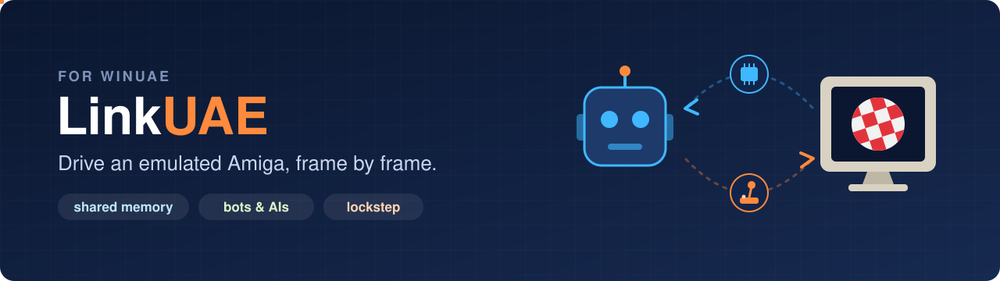
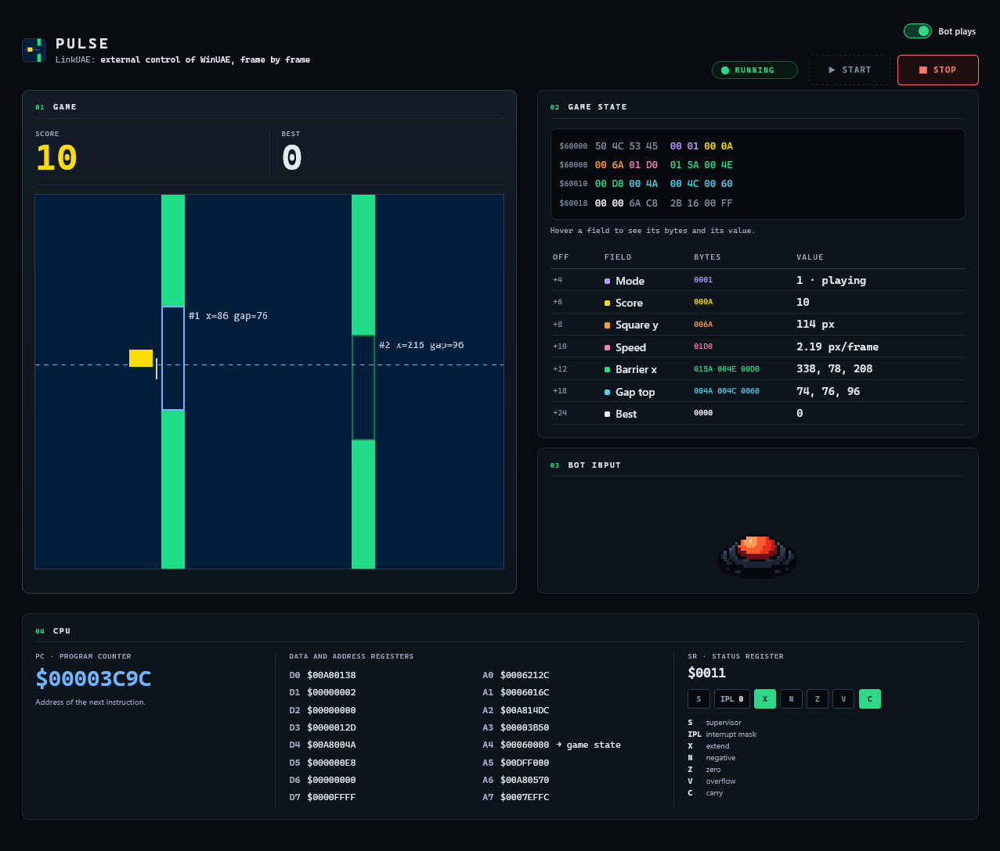
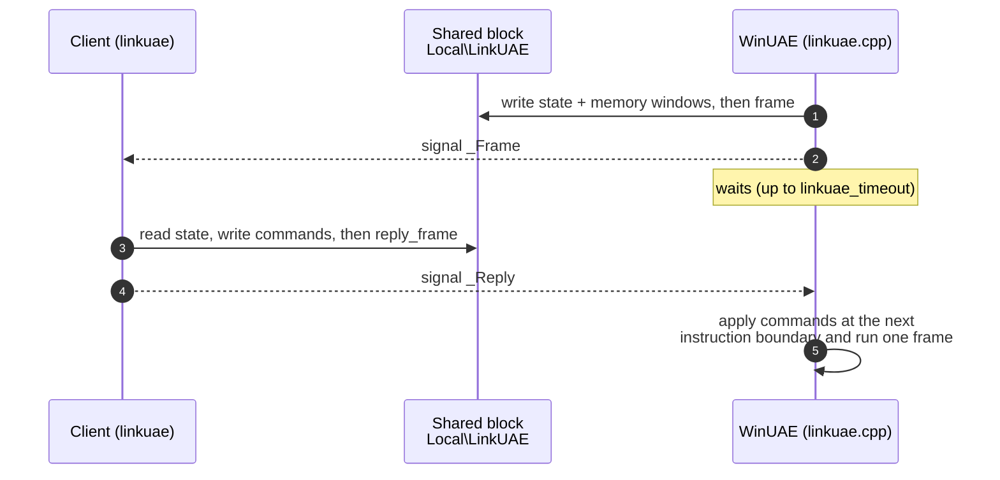

<p align="center">
  
</p>

<p align="center">
  
  
  
  
</p>

<p align="center">
  <b>Read the Amiga's memory, registers and custom chips on every frame, and answer with joystick, keys and writes.</b><br>
  Low latency, lockstep, no busy waiting. Made for bots, AIs and automated testing.
</p>

<p align="center">
  <a href="#quick-start">Quick start</a> ·
  <a href="#how-it-works">How it works</a> ·
  <a href="#python-client">Python client</a> ·
  <a href="#build">Build</a>
</p>

> [!NOTE]
> This is a fork of [WinUAE](https://github.com/tonioni/WinUAE) by Toni Wilen and contributors, with **LinkUAE** added on top.
> The original WinUAE build guide is unchanged in the root [README.md](../README.md).

---

## ✨ What you get

| | |
|---|---|
| 🔍 **Full state, every frame** | `pc`, `sr`, `d0-d7`, `a0-a7`, stacks, beam position and the 512 bytes of custom chips at `$DFF000`. |
| 🧠 **Memory windows** | Up to 64 regions (1 MB in total) copied for you on each frame. |
| 🕹️ **Input** | Joystick on ports 0 and 1, keyboard and mouse. |
| ✏️ **Writes** | Memory (8/16/32 bits), registers `D0-A7` and custom chips, applied safely at an instruction boundary (`PC` and `SR` are read-only). |
| 🔁 **Lockstep** | The emulator waits for your answer, so a slow client does not change the game: it only runs slower. Runs are not deterministic, though ([why](#determinism)). |
| ⚡ **Shared memory** | No sockets and no serialization: both processes map one named memory block, and Windows events wake each side. |

<a id="quick-start"></a>

## 🎮 Try it in one minute

The [**Pulse**](../linkuae/demos/pulse/README.md) demo is a tiny original game that fits in a floppy's boot sector, a Python bot that plays it and a web panel showing what the bot reads and sends. It needs **no Kickstart and no Workbench** (it boots on WinUAE's built-in AROS ROM).

1. Get this repository (clone it, or **Code → Download ZIP**) and install [Python](https://www.python.org/) 3.9+ on `PATH`. The demos and the Python client live here; Releases only has the emulator.
2. Get `winuae64.exe` with LinkUAE from [**Releases**](https://github.com/fernando-cabrera-gonzalez/linkuae/releases/latest) (unzip it anywhere), or [build it](#build). The game disk, `pulse.adf`, comes ready-made: no assembler needed.
3. Open a command prompt in the repository folder (with **Download ZIP** it is called `linkuae-master`) and start the panel, giving it the path of your `winuae64.exe`:
   ```bat
   cd linkuae\demos\pulse
   python panel.py C:\Emulators\LinkUAE\winuae64.exe --start
   ```
   Replace the example path with yours (in quotes if it has spaces), or leave it out if you built the emulator. To skip it from then on, set the `WINUAE` environment variable once: `setx WINUAE "C:\Emulators\LinkUAE\winuae64.exe"` (then open a new console: `setx` does not change the current one).
4. Watch the bot play at `http://127.0.0.1:8765/`, or switch it off and play yourself.

<p align="center"></p>

> [!TIP]
> Want to see it on a real commercial game? The [**Battle Squadron**](../linkuae/demos/battlesquadron/README.md) demo is a bot for the 1989 shooter; [in the video](https://www.youtube.com/watch?v=IycfD-8ZWN4) it plays the whole game without losing a life. It needs your own Kickstart ROM and game disk.

<a id="how-it-works"></a>

## ⚙️ How it works

One frame at a time, the emulator and your client take turns on a shared memory block:



- **One owner at a time.** Writing `frame` (emulator) or `reply_frame` (client) is the last write before handing the block over, so no other lock is needed.
- **Events only say *when*.** The data always travels in the block.
- **One client, one emulator.** Only one WinUAE can have LinkUAE open, and only one client can drive it.

<a id="python-client"></a>

## 🐍 Python client

`linkuae/python/linkuae` has no dependencies beyond the standard library.

```python
from linkuae import Link

with Link() as link:
    link.set_windows([(0x0000, 0x100), (0xC00000, 64)])  # (address, length)
    while True:
        f = link.wait_frame()        # f.u16(addr), f.read(addr, n), registers...
        if f is None:                # no frame in 1 s: emulator paused
            continue
        link.joy(1, right=True, fire=True)
        link.step()                  # send the commands, let the next frame run
```

| Method | Purpose |
|---|---|
| `wait_frame()` · `step()` | Receive a frame · answer it |
| `set_windows()` | Choose the memory regions to copy |
| `joy()` · `key()` · `mouse()` | Input |
| `write_u8/16/32()` · `set_reg()` · `write_custom()` | Writes to memory, registers, custom chips |
| `write_results()` · `stats()` · `emulator_present()` | Results, timing, detection |

> [!IMPORTANT]
> A `Frame` reads straight from the shared block and is only valid until `step()`; after that it raises `StaleFrame`. New windows and `write_results()` show up from the next frame on.

<a id="enable-it"></a>

## 🔌 Enable it

Add to the `.uae` configuration:

```ini
linkuae=true
linkuae_timeout=1000     ; ms to wait for the client (1-60000)
linkuae_wait=30000       ; optional: hold the first frame after start/reset/savestate until a client attaches (ms, 0 = off, up to 600000)
```

Without `linkuae_wait` the emulator runs freely until the client attaches, so a client's first frame lands on a different emulated moment each time. `rndseed=1` (any non-zero value) fixes WinUAE's random seed, which otherwise comes from the PC's clock and changes the floppy timing. Both reduce the differences between runs, but they do not make runs identical. While `linkuae_wait` holds the first frame, the WinUAE window does not respond; it carries on as soon as a client attaches or the time runs out.

<a id="determinism"></a>

> [!WARNING]
> **Runs are not deterministic.** LinkUAE removes the timing between the emulator and the client, but many other things feed the emulated machine and the client, and most of them are outside LinkUAE's control. Any of them can make two runs differ:
>
> - **Emulator**: the exact WinUAE build and every option of the configuration (CPU, chipset, memory, timing, floppy speed...). A different version may emulate a single cycle differently.
> - **Software**: the same Kickstart ROM, the same copy of the disk and the same savestate, byte for byte.
> - **Start point**: without `linkuae_wait` the first frame the client sees changes from run to run; a cold boot and a savestate restore are different starts.
> - **Random seed**: `rndseed` left at 0 seeds WinUAE from the PC's clock, and the floppy emulation uses it.
> - **Timeouts**: a frame the client does not answer within `linkuae_timeout` runs without its commands (a stalled PC, a debugger, a long garbage collection).
> - **Anything else reaching the Amiga**: keys, mouse or joystick pressed in the emulator window, the battery-backed clock (it reads the PC's time), folders or files mounted as hard disks, serial/parallel/network, the shared clipboard, and the GUI (pausing, inserting disks, resets, saving or loading savestates).
> - **The client itself**: wall-clock time, random numbers or thread timing in its decisions, and its libraries: floating-point results can change with the Python, numpy or CPU (SIMD paths), and one different decision changes everything after it.
>
> A run can diverge from another at any point, sometimes thousands of frames in.

<a id="build"></a>

## 🛠️ Build

> [!TIP]
> No need to build it yourself: a ready-to-run `winuae64.exe` is attached to each [release](https://github.com/fernando-cabrera-gonzalez/linkuae/releases/latest). Unzip it anywhere and give its path to `panel.py`, or set the `WINUAE` environment variable to it.

| | |
|---|---|
| **Requirements** | Windows, Visual Studio 2022, the WinUAE dependencies from the [original guide](../README.md) |
| **Command** | `linkuae\build\build.cmd` (FullRelease x64) |
| **Output** | `linkuae\build\out\winuae64.exe` |

<details>
<summary><b>Portable test folder</b> (keeps your normal WinUAE install untouched)</summary>

```bat
python -I linkuae\tools\make_test_folder.py <install> <destination>
```

Copies the Configurations, Kickstarts, Savestates and ADF folders, rewrites the paths in the `.uae` files and exports the registry settings to `winuae.ini`.
</details>

<details>
<summary><b>What changes in WinUAE's code</b></summary>

`linkuae.cpp` and `include/linkuae.h` are new. Everything else is a minimal hook:

| File | Hook |
|---|---|
| `cfgfile.cpp`, `include/options.h` | `linkuae`, `linkuae_timeout` and `linkuae_wait` options |
| `devices.cpp` | `linkuae_instruction_boundary()` (CPU callback) and `linkuae_close()` |
| `inputdevice.cpp` | `linkuae_vsync()` |
| `od-win32/sysconfig.h`, `.vcxproj*` | defines `WITH_LINKUAE` and adds `linkuae.cpp` |

`include/linkuae.h` and `linkuae/python/linkuae/protocol.py` must stay identical; bump `LINKUAE_VERSION` on any change.
</details>

## 📂 Where things are

```
linkuae/
├── build/build.cmd         builds winuae64.exe with LinkUAE
├── python/linkuae/         Python client
├── demos/pulse/            game + bot + web panel
├── demos/battlesquadron/   bot + web panel for Battle Squadron (bring your own ROM and disk)
└── tools/                  portable test folder generator
```

## 📜 License

GPL-2.0, like WinUAE (see [COPYING](../COPYING)). LinkUAE was added to WinUAE in 2026; the files it touches are listed above.
