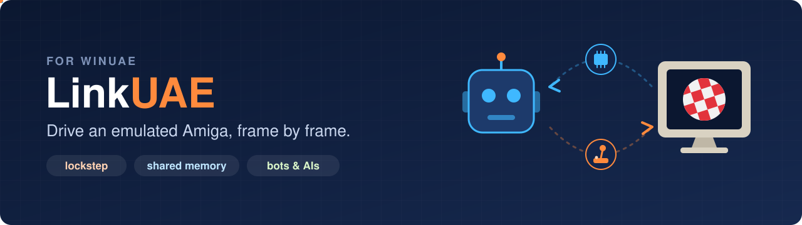
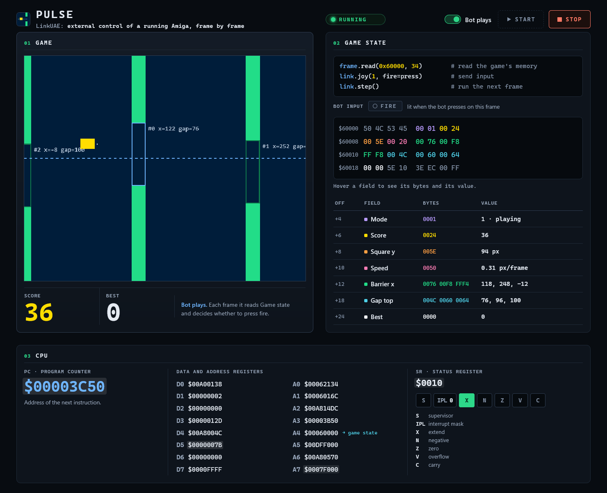
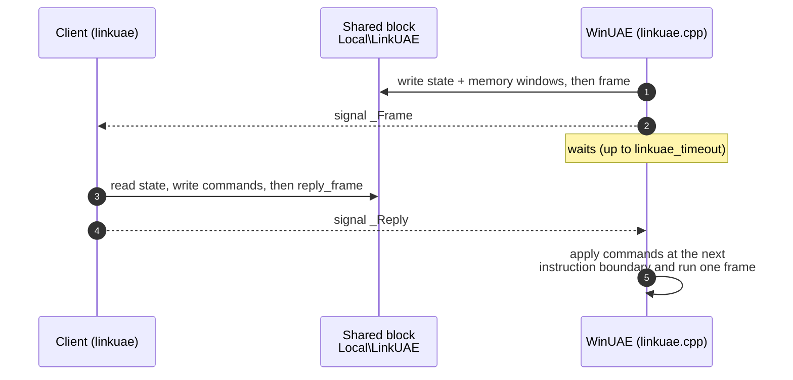

<p align="center">
  
</p>

<p align="center">
  
  
  
  
</p>

<p align="center">
  <b>Read the Amiga's memory, registers and custom chips on every frame, and answer with joystick, keys and writes.</b><br>
  Low latency, deterministic, no busy waiting. Made for bots, AIs and automated testing.
</p>

<p align="center">
  <a href="#quick-start">Quick start</a> ·
  <a href="#how-it-works">How it works</a> ·
  <a href="#python-client">Python client</a> ·
  <a href="#build">Build</a>
</p>

> [!NOTE]
> This is a fork of [WinUAE](https://github.com/tonioni/WinUAE) by Toni Wilen and contributors, with **LinkUAE** added on top.
> The original WinUAE build guide is unchanged in the root [README.md](../README.md).

---

## ✨ What you get

| | |
|---|---|
| 🔍 **Full state, every frame** | `pc`, `sr`, `d0-d7`, `a0-a7`, stacks, beam position and the 512 bytes of custom chips at `$DFF000`. |
| 🧠 **Memory windows** | Up to 64 regions (1 MB in total) copied for you on each frame. |
| 🕹️ **Input** | Joystick on ports 0 and 1, keyboard and mouse. |
| ✏️ **Writes** | Memory (8/16/32 bits), registers `D0-A7` and custom chips, applied safely at an instruction boundary (`PC` and `SR` are read-only). |
| 🔁 **Lockstep** | The emulator waits for your answer: same ROM, disk and bot give the same run every time. |
| ⚡ **Zero copies** | Both processes share one named memory block; Windows events wake each side. |

<a id="quick-start"></a>

## 🎮 Try it in one minute

The [**Pulse**](../linkuae/demos/pulse/README.md) demo is a tiny original game that fits in a floppy's boot sector, a Python bot that plays it and a web panel showing what the bot reads and sends. It needs **no Kickstart and no Workbench** (it boots on WinUAE's built-in AROS ROM).

1. Get `winuae64.exe` with LinkUAE from [**Releases**](https://github.com/fernando-cabrera-gonzalez/linkuae/releases/latest), or [build it](#build). The game disk, `pulse.adf`, comes ready-made: no assembler needed.
2. Downloaded from Releases? Open `linkuae\demos\pulse\start_demo.cmd` in a text editor and write the exe's full path in the line marked `EDIT HERE`:
   ```bat
   set "WINUAE_EXE=C:\Emulators\LinkUAE\winuae64.exe"
   ```
   If you built it yourself, skip this step: it is found in `linkuae\build\out`.
3. Double-click `start_demo.cmd`.
4. Watch the bot play at `http://127.0.0.1:8765/`, or switch it off and play yourself.

<!-- Screenshot of the panel: save it as .github/assets/pulse-panel.png and uncomment.
<p align="center"></p>
-->

<a id="how-it-works"></a>

## ⚙️ How it works

One frame at a time, the emulator and your client take turns on a shared memory block:



- **One owner at a time.** Writing `frame` (emulator) or `reply_frame` (client) is the last write before handing the block over, so no other lock is needed.
- **Events only say *when*.** The data always travels in the block.
- **One client, one emulator.** Only one WinUAE can have LinkUAE open, and only one client can drive it.

<a id="python-client"></a>

## 🐍 Python client

`linkuae/python/linkuae` has no dependencies beyond the standard library.

```python
from linkuae import Link

with Link() as link:
    link.set_windows([(0x0000, 0x100), (0xC00000, 64)])  # (address, length)
    while True:
        f = link.wait_frame()        # f.u16(addr), f.read(addr, n), registers...
        if f is None:                # no frame in 1 s: emulator paused
            continue
        link.joy(1, right=True, fire=True)
        link.step()                  # send the commands, let the next frame run
```

| Method | Purpose |
|---|---|
| `wait_frame()` · `step()` | Receive a frame · answer it |
| `set_windows()` | Choose the memory regions to copy |
| `joy()` · `key()` · `mouse()` | Input |
| `write_u8/16/32()` · `set_reg()` · `write_custom()` | Writes to memory, registers, custom chips |
| `write_results()` · `stats()` · `emulator_present()` | Results, timing, detection |

> [!IMPORTANT]
> A `Frame` reads straight from the shared block and is only valid until `step()`; after that it raises `StaleFrame`. New windows and `write_results()` show up from the next frame on.

## 🔌 Enable it

Add to the `.uae` configuration:

```ini
linkuae=true
linkuae_timeout=1000     ; ms to wait for the client (1-60000)
```

<a id="build"></a>

## 🛠️ Build

> [!TIP]
> No need to build it yourself: a ready-to-run `winuae64.exe` is attached to each [release](https://github.com/fernando-cabrera-gonzalez/linkuae/releases/latest). Unzip it anywhere and write its path in `WINUAE_EXE` at the top of `start_demo.cmd`.

| | |
|---|---|
| **Requirements** | Windows, Visual Studio 2022, the WinUAE dependencies from the [original guide](../README.md) |
| **Command** | `linkuae\build\build.cmd` (FullRelease x64) |
| **Output** | `linkuae\build\out\winuae64.exe` |

<details>
<summary><b>Portable test folder</b> (keeps your normal WinUAE install untouched)</summary>

```bash
python -I linkuae\tools\make_test_folder.py <install> <destination>
```

Clones Configurations, Kickstarts, Savestates and ADFs, rewrites the paths in the `.uae` files and exports the registry settings to `winuae.ini`.
</details>

<details>
<summary><b>What changes in WinUAE's code</b></summary>

`linkuae.cpp` and `include/linkuae.h` are new. Everything else is a minimal hook:

| File | Hook |
|---|---|
| `cfgfile.cpp`, `include/options.h` | `linkuae` and `linkuae_timeout` options |
| `devices.cpp` | `linkuae_instruction_boundary()` (CPU callback) and `linkuae_close()` |
| `inputdevice.cpp` | `linkuae_vsync()` |
| `od-win32/sysconfig.h`, `.vcxproj*` | defines `WITH_LINKUAE` and adds `linkuae.cpp` |

`include/linkuae.h` and `linkuae/python/linkuae/protocol.py` must stay identical; bump `LINKUAE_VERSION` on any change.
</details>

## 📂 Where things are

```
linkuae/
├── build/build.cmd      builds winuae64.exe with LinkUAE
├── python/linkuae/      Python client
├── demos/pulse/         game + bot + web panel
└── tools/               portable test folder generator
```

## 📜 License

GPL-2.0, like WinUAE (see [COPYING](../COPYING)). LinkUAE was added to WinUAE in 2026; the files it touches are listed above.
