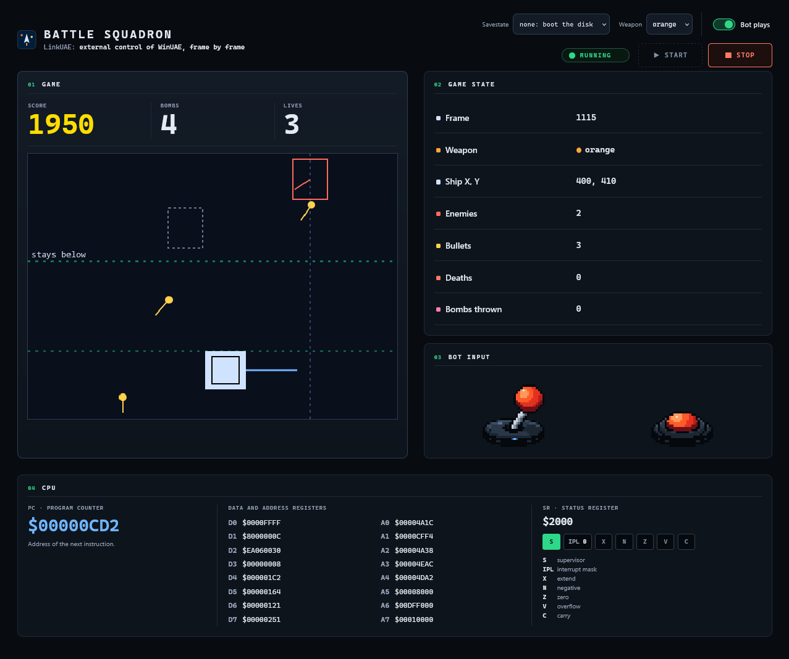

<h1 align="center">🚀 Battle Squadron</h1>

<p align="center">
  
  
  
  <a href="https://www.youtube.com/watch?v=IycfD-8ZWN4"></a>
</p>

<p align="center">
  <b>A <a href="../../../.github/README.md">LinkUAE</a> bot that plays a real commercial Amiga game.</b><br>
  Battle Squadron (Innerprise, 1989), played start to finish by a Python bot that reads the game's memory every frame,<br>
  plans its path through the bullets and answers with the joystick, with a web panel showing what it sees and does.
</p>

<p align="center">
  <a href="https://www.youtube.com/watch?v=IycfD-8ZWN4"></a><br>
  ▶️ <b><a href="https://www.youtube.com/watch?v=IycfD-8ZWN4">Watch the bot play a perfect game</a></b>: the whole game, no lives lost, with the panel beside it.
</p>

<p align="center">
  <a href="#what-you-need">What you need</a> ·
  <a href="#run-it">Run it</a> ·
  <a href="#the-panel">The panel</a> ·
  <a href="#every-game-is-different">Every game is different</a>
</p>

---

## ✨ What it is

A ship flies up a scrolling battlefield, shooting air and ground enemies and dodging their bullets. Battle Squadron is © its respective owners; this project is not affiliated with them and includes no part of the game.

| | |
|---|---|
| 🎮 **The game** | Battle Squadron, the vertical shooter, untouched: the bot plays the game through LinkUAE, no patches. |
| 🤖 **The bot** | `bot.py` + `player.py`: reads the enemies, ground targets and bullets from the game's RAM, plans the ship's path 28 frames ahead and fires, bombs and picks up weapons. |
| 📊 **The panel** | `panel.py` + a web page: the game redrawn from memory with the bot's plan on top, its state, the joystick it sends and the 68000 registers. |
| 🏆 **Perfect game** | In the video the bot plays the whole game **without losing a life**. |

<a id="what-you-need"></a>

## 📋 What you need

| | |
|---|---|
| **System** | Windows: LinkUAE uses Windows shared memory and events |
| **Emulator** | WinUAE built with LinkUAE from this repository, with `linkuae_wait` support ([Releases](https://github.com/fernando-cabrera-gonzalez/linkuae/releases/latest) or `linkuae\build\build.cmd`) |
| **Kickstart** | An A500 Kickstart ROM suitable for the game: yours, not included |
| **Game** | Your original copy of the **Battle Squadron** disk (as an ADF): not included |
| **Python** | 3.9+ with `numpy`; `numba` optional (the same planner, about 5 times faster: `pip install numpy numba`) |
| **Browser** | Any |

> [!IMPORTANT]
> The Kickstart ROM and the game are copyrighted and are **not** in this repository. `bsquad.uae` comes with two placeholders: **replace each with the full path to your own file** before running anything:
> ```ini
> kickstart_rom_file=<full path to your Kickstart ROM>
> floppy0=<full path to your Battle Squadron ADF>
> ```

> [!NOTE]
> The bot reads the game's RAM at fixed addresses, measured on one copy of the game with the configuration in `bsquad.uae`. Other versions of the game or other machine setups may put things elsewhere, and then the bot will not see the game.

<a id="run-it"></a>

## 🚀 Run it

> [!IMPORTANT]
> Close any other WinUAE with LinkUAE enabled first: only one can be controlled, and `panel.py` must be its only client. A second panel on the same port refuses to start instead of fighting the first.

```bat
cd linkuae\demos\battlesquadron
python panel.py C:\Emulators\LinkUAE\winuae64.exe --start
```

From a command prompt in the repository folder. Replace the example path with that of your `winuae64.exe` (in quotes if it has spaces), or leave it out if you built the emulator or set `WINUAE` (see below). The panel opens at `http://127.0.0.1:8765/` (reachable only from your machine) and boots the game disk; without `--start`, press **Start** in the panel. With `numba` installed, it first compiles the planner for a few seconds. Then start a game in the WinUAE window (cursor keys, right Ctrl fires): the bot takes over as soon as the ship is on screen. Until then the screen shows the game loading and its title.

### 📍 Where it finds WinUAE

`panel.py` takes the first of these that is set (if that one does not exist, it says so and stops):

| # | Where | Notes |
|---|---|---|
| 1 | First argument | `python panel.py C:\Emulators\LinkUAE\winuae64.exe` |
| 2 | `WINUAE` environment variable | Set it once for every demo: `setx WINUAE "C:\Emulators\LinkUAE\winuae64.exe"` (then open a new console) |
| 3 | `linkuae\build\out\winuae64.exe` | Where `build.cmd` leaves it: nothing to do if you built it |

### ⚙️ Options

| Option | What it does |
|---|---|
| `--start` | Boots WinUAE right away instead of waiting for the **Start** button |
| `--port N` | Local port of the panel (default 8765) |
| `--no-browser` | Does not open the page |
| `--state my_game.uss` | Starts from one of your savestates in this folder instead of booting the disk (see below) |
| `--press-p` | Presses **P** once at the start, for a savestate saved with the game paused |
| `--want orange` | Pick-up colour the bot goes for at start: `any` (default), `red`, `blue`, `green` or `orange` |
| `--horizon N` | Game ticks the bot plans ahead (default 14) |

The bot plays whatever is running in the emulator: you can also load a savestate or another copy of the game from WinUAE (**F12**) at any time, and after a reset or a savestate loaded there it starts over.

**Savestates (optional).** To start right at a given point, save one from WinUAE (**F12**, *Save State*) into this folder, then pick it in the panel's **Savestate** list or give it with `--state`. Add `--press-p` if you saved it with the game paused (that is how the game in the video was started).

> [!TIP]
> Want to place the WinUAE window first (for a recording, say)? Press **Start**, move the window, **Stop**, **Start** again: WinUAE remembers where it was, and every **Start** restarts the game from the very beginning.

<a id="the-panel"></a>

## 📊 The panel

<p align="center"></p>

| Section | Shows |
|---|---|
| 🎮 **Game** | Score, bombs and lives, and the playfield redrawn from RAM: the ship, enemies, ground targets and bullets with their predicted motion, plus the bot's target and planned path |
| 🧠 **Game state** | Frame, weapon, ship position, enemies and bullets on screen, deaths and bombs thrown |
| 🕹️ **Bot input** | The joystick and fire button the bot sends, frame by frame |
| 🖥️ **CPU** | The 68000 registers (PC, D0-D7, A0-A7, SR) as LinkUAE publishes them at the start of each frame |

**Bot plays** hands the joystick to the bot; switch it off and play yourself in the WinUAE window (cursor keys, right Ctrl fires). **Weapon** chooses the pick-up colour the bot goes for, avoiding the others (`--want orange` sets it at start; *any* by default, and the game in the video was played with orange). The console logs every bomb, weapon change and death, and a status line every 100 frames.

<a id="every-game-is-different"></a>

## ⚠️ Every game is different

> [!WARNING]
> **The bot is not infallible, and runs are not deterministic.** The perfect game is the one in the video: one particular savestate (not distributed), this bot, this emulator build and this configuration. Your games will be others, and even two runs on the same PC can differ: a single different frame early on leads to a completely different game later, and some enemies appear without warning right where the ship is, so the bot may well die.
>
> The emulator waits for the bot on every frame (`linkuae_timeout=60000`), so a slow PC only plays slower. `bsquad.uae` also sets `linkuae_wait` (the first frame waits for the bot) and `rndseed=1` (a fixed random seed for the floppy timing) to reduce the differences between runs. See [why runs differ](../../../.github/README.md#determinism).

## 📂 Files

| File | What it is |
|---|---|
| `panel.py` | Local web server: runs the emulator and the bot, and feeds the page |
| `panel.html`, `panel.js`, `stick.png`, `button.png` | The page and its joystick and button sprites |
| `player.py` | The bot driven frame by frame by the panel |
| `bot.py` | The bot's brain (reading the RAM, planning, bombs), and a bare console loop for an emulator that is already running (`python bot.py --want orange --frames 100000`; it saves the RAM of the frames before each death and bomb in `deaths/`; `--no-ram-traces` turns that off) |
| `plan_nb.py` | The planner's heavy part compiled with Numba, used when `numba` is installed (the same algorithm as the numpy code in `bot.py`) |
| `restart.ps1` | Restarts WinUAE for the console loop: boots the disk, or a savestate with `-State my_game.uss`; `-Exe` defaults to `WINUAE`, then `linkuae\build\out`. It closes every running WinUAE first, without asking |
| `bsquad.uae` | Emulator configuration: A500, 512 KB chip + 512 KB slow RAM, LinkUAE, `linkuae_wait` and `rndseed` (edit the ROM and disk paths) |
