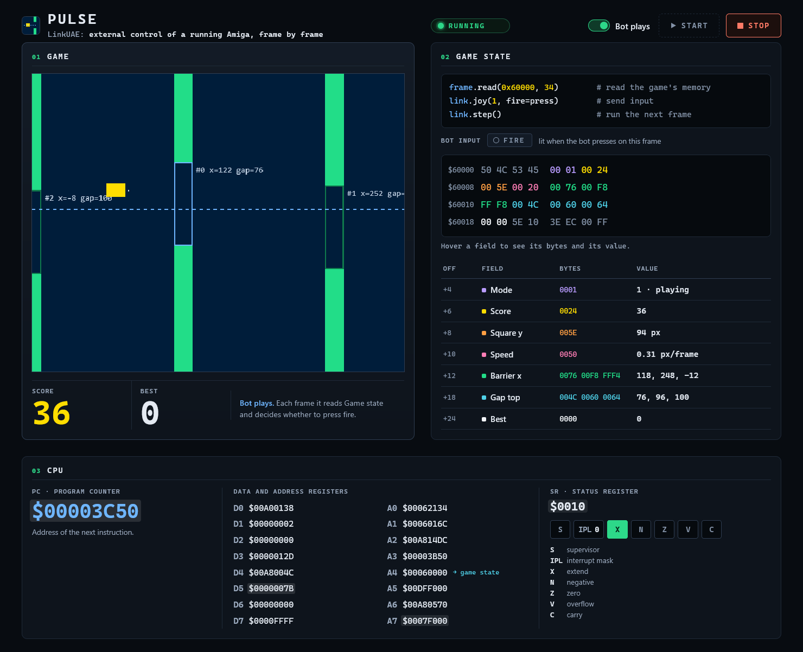

<h1 align="center">🟧 Pulse</h1>

<p align="center">
  
  
  
  
</p>

<p align="center">
  <b>A self-contained <a href="../../../.github/README.md">LinkUAE</a> demo.</b><br>
  A tiny original game that fits in a floppy's boot sector, a Python bot that plays it,<br>
  and a web panel showing what the bot reads and sends.
</p>

<p align="center">
  <a href="#run-it">Run it</a> ·
  <a href="#the-panel">The panel</a> ·
  <a href="#how-the-bot-sees-the-game">How the bot sees the game</a> ·
  <a href="#build-the-disk">Build the disk</a>
</p>

---

## ✨ What it is

A square falls, each button press pushes it up, and barriers with a gap come from the right.

| | |
|---|---|
| 🎮 **The game** | `pulse.s`, 68000 assembly, 1012 bytes at most. It takes over the machine and draws with hardware sprites. |
| 🤖 **The bot** | `bot.py`: reads one 34-byte block of the game's memory each frame and answers with the fire button. |
| 📊 **The panel** | `panel.py` + a web page: the game drawn from its state, the raw bytes and the CPU registers. |

> [!NOTE]
> It needs **no Kickstart and no Workbench**: it boots on the AROS ROM built into WinUAE, with the configuration in `pulse.uae`.

## 📋 Requirements

| | |
|---|---|
| **System** | Windows: LinkUAE uses Windows shared memory and events |
| **Emulator** | WinUAE built with LinkUAE ([Releases](https://github.com/fernando-cabrera-gonzalez/linkuae/releases/latest) or `linkuae\build\build.cmd`) |
| **Python** | 3.9+, no extra packages: `bot.py` finds `linkuae\python\linkuae` in this repo |
| **Browser** | Any |
| **Rebuilding the disk** | Only then: vasm for 68000, Motorola syntax (`vasmm68k_mot`), on `PATH` |

<a id="run-it"></a>

## 🚀 Run it

> [!IMPORTANT]
> Close any other WinUAE with LinkUAE enabled first: only one can be controlled. Likewise, a second panel on the same port refuses to start instead of fighting the first.

Double-click **`start_demo.cmd`**. It starts the panel at `http://127.0.0.1:8765/` (reachable only from your machine), opens it in the browser and boots the game.

### 📍 Pointing it at your WinUAE

`start_demo.cmd` looks for the emulator in this order and takes the first that is set (if that one does not exist, it stops there instead of trying the next):

| # | Where | Notes |
|---|---|---|
| 1 | Command-line argument | `start_demo.cmd path\to\winuae64.exe` |
| 2 | `WINUAE_EXE` in the script | The line marked `EDIT HERE` |
| 3 | `WINUAE` environment variable | |
| 4 | `linkuae\build\out\winuae64.exe` | Where `build.cmd` leaves it: nothing to do if you built it |

Downloaded it from Releases, or keep it elsewhere? Open `start_demo.cmd` in a text editor and write the full path:

```bat
set "WINUAE_EXE=C:\Emulators\LinkUAE\winuae64.exe"
```

By hand:

```bash
python panel.py path\to\winuae64.exe --start
```

Without `--start`, the panel waits for its **Start** button.

<a id="the-panel"></a>

## 📊 The panel

<p align="center"></p>

| Section | Shows |
|---|---|
| 🎮 **Game** | The screen drawn from the state block, plus the bot's view: the height it aims at (dashed line) and a mark when it presses |
| 🧠 **Game state** | The bytes read from `$60000` each frame, decoded, and the fire button the bot sends back. Hover a byte to see its field |
| 🖥️ **CPU** | The 68000 registers as LinkUAE publishes them, at the start of each frame |

**Bot plays** hands the button to the bot. Turn it off and play in the WinUAE window with the left mouse button.

> [!WARNING]
> `panel.py` is the only LinkUAE client. Two clients on one emulator would interfere with each other.

<a id="how-the-bot-sees-the-game"></a>

## 🔍 How the bot sees the game

The game keeps its state at a fixed address, **`$60000`**, so the client opens one 34-byte memory window on it. All values are big-endian.

| Offset | Size | Field |
|---:|---|---|
| 0 | long | Signature `PLSE`: written last, once the game is ready |
| 4 | word | Mode: 0 waiting for the button, 1 playing, 2 game over |
| 6 | word | Score |
| 8 | word | Square y, in pixels |
| 10 | word | Square speed, in 1/256 pixel per frame |
| 12 | 3 words | x of each barrier |
| 18 | 3 words | Top y of each gap |
| 24 | word | Best score |
| 26 | word | Square y with 8 fraction bits |
| 28 | word | State of the course generator |
| 30 | byte | Button on the last frame (0 up); byte 31 is not used |
| 32 | word | Frames left before a restart is accepted |

On each frame the client reads that block, decides, and answers with the fire button:

```python
frame = link.wait_frame()
...                            # read the state and decide
link.joy(1, fire=press)
link.step()
```

<details>
<summary><b>Why a fixed address works here</b></summary>

Pulse is a boot-sector game: when it runs there is no operating system and nobody hands out memory, so it lays out its own map with constants (`STATE`, `COPPER`, sprites, bitplane and stack, all inside the first 512 KB of chip RAM). The bot repeats the one constant it needs.

A program loaded by AmigaDOS lands wherever the system puts it, so a bot for it has to find the address first: from a register the program keeps (`a4` here points at the state), by walking system structures from `ExecBase` at `$4`, or from a signature. Windows can be requested at any time and arrive with the next frame.
</details>

<a id="build-the-disk"></a>

## 🛠️ Build the disk

`pulse.adf` comes ready-made; rebuild it only after changing `pulse.s`. With `vasmm68k_mot` on `PATH`:

```bash
python build_demo.py
```

It assembles the game, checks that it fits in the boot sector (1012 bytes), adds the boot block checksum and writes `pulse.adf`. The build is byte-identical, so the disk can be checked against the source.

## 📂 Files

| File | What it is |
|---|---|
| `start_demo.cmd` | Starts everything: finds WinUAE and runs `panel.py --start` |
| `panel.py` | Local web server: runs the emulator and the bot, and feeds the page |
| `panel.html`, `panel.js` | The page |
| `bot.py` | The bot's logic, and a bare console loop for an emulator that is already running |
| `pulse.s` | Source of the game, in 68000 assembly |
| `build_demo.py` | Builds `pulse.adf` from `pulse.s` |
| `pulse.adf` | The game disk |
| `pulse.uae` | Emulator configuration: 68000, 512 KB of chip RAM, built-in AROS ROM, `linkuae=true` |

## 🔁 Reproducible

The course is fixed and the protocol is lockstep, so with the same ROM, disk and bot every game is the same. Runs from a cold start gave identical hashes of the game state and sprite memory over 2000 frames, counted from the moment the game is ready. The boot itself can take a few frames more or less.
