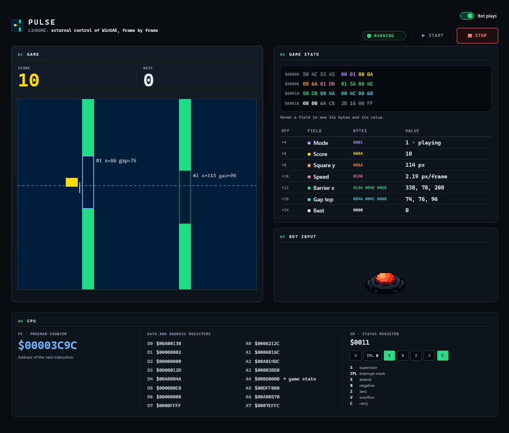

<h1 align="center">🟧 Pulse</h1>

<p align="center">
  
  
  
  
  <a href="https://www.youtube.com/watch?v=sLp_Mc7ky3E"></a>
</p>

<p align="center">
  <b>A self-contained <a href="../../../.github/README.md">LinkUAE</a> demo.</b><br>
  A tiny original game that fits in a floppy's boot sector, a Python bot that plays it,<br>
  and a web panel showing what the bot reads and sends.
</p>

<p align="center">
  <a href="https://www.youtube.com/watch?v=sLp_Mc7ky3E"></a><br>
  ▶️ <b><a href="https://www.youtube.com/watch?v=sLp_Mc7ky3E">Watch the bot play Pulse</a></b>, with the panel beside it.
</p>

<p align="center">
  <a href="#what-you-need">What you need</a> ·
  <a href="#run-it">Run it</a> ·
  <a href="#the-panel">The panel</a> ·
  <a href="#how-the-bot-sees-the-game">How the bot sees the game</a> ·
  <a href="#build-the-disk">Build the disk</a> ·
  <a href="#every-game-is-different">Every game is different</a>
</p>

---

## ✨ What it is

A square falls, each button press pushes it up, and barriers with a gap come from the right.

| | |
|---|---|
| 🎮 **The game** | `pulse.s`, 68000 assembly, 1012 bytes at most. It takes over the machine and draws with hardware sprites. |
| 🤖 **The bot** | `bot.py`: reads one 34-byte block of the game's memory each frame and answers with the fire button. |
| 📊 **The panel** | `panel.py` + a web page: the game drawn from its state with the bot's aim on top, the raw bytes, the button it sends and the 68000 registers. |

> [!NOTE]
> It needs **no Kickstart and no Workbench**: it boots on the AROS ROM built into WinUAE, with the configuration in `pulse.uae`.

<a id="what-you-need"></a>

## 📋 What you need

| | |
|---|---|
| **System** | Windows: LinkUAE uses Windows shared memory and events |
| **Emulator** | WinUAE built with LinkUAE ([Releases](https://github.com/fernando-cabrera-gonzalez/linkuae/releases/latest) or `linkuae\build\build.cmd`) |
| **Python** | 3.9+, no extra packages: `bot.py` finds `linkuae\python\linkuae` in this repo |
| **Browser** | Any |
| **Rebuilding the disk** | Only then: vasm for 68000, Motorola syntax (`vasmm68k_mot`), on `PATH` |

<a id="run-it"></a>

## 🚀 Run it

> [!IMPORTANT]
> Close any other WinUAE with LinkUAE enabled first: only one can be controlled, and `panel.py` must be its only client. A second panel on the same port refuses to start instead of fighting the first.

```bat
cd linkuae\demos\pulse
python panel.py C:\Emulators\LinkUAE\winuae64.exe --start
```

From a command prompt in the repository folder. Replace the example path with that of your `winuae64.exe` (in quotes if it has spaces), or leave it out if you built the emulator or set `WINUAE` (see below). The panel opens at `http://127.0.0.1:8765/` (reachable only from your machine) and boots the game; the bot plays as soon as it is ready. Without `--start`, press **Start** in the panel.

### 📍 Where it finds WinUAE

`panel.py` takes the first of these that is set (if that one does not exist, it says so and stops):

| # | Where | Notes |
|---|---|---|
| 1 | First argument | `python panel.py C:\Emulators\LinkUAE\winuae64.exe` |
| 2 | `WINUAE` environment variable | Set it once for every demo: `setx WINUAE "C:\Emulators\LinkUAE\winuae64.exe"` (then open a new console) |
| 3 | `linkuae\build\out\winuae64.exe` | Where `build.cmd` leaves it: nothing to do if you built it |

### ⚙️ Options

| Option | What it does |
|---|---|
| `--start` | Boots WinUAE right away instead of waiting for the **Start** button |
| `--port N` | Local port of the panel (default 8765) |
| `--no-browser` | Does not open the page |

<a id="the-panel"></a>

## 📊 The panel

<p align="center"></p>

| Section | Shows |
|---|---|
| 🎮 **Game** | The screen drawn from the state block, plus the bot's view: the height it aims at (dashed line) and a mark when it presses |
| 🧠 **Game state** | The bytes read from `$60000` each frame, decoded. Hover a byte to see its field |
| 🕹️ **Bot input** | The fire button the bot sends, frame by frame |
| 🖥️ **CPU** | The 68000 registers (PC, D0-D7, A0-A7, SR) as LinkUAE publishes them at the start of each frame |

**Bot plays** hands the button to the bot; switch it off and play yourself in the WinUAE window (left mouse button).

<a id="how-the-bot-sees-the-game"></a>

## 🔍 How the bot sees the game

The game keeps its state at a fixed address, **`$60000`**, so the client opens one 34-byte memory window on it. All values are big-endian.

| Offset | Size | Field |
|---:|---|---|
| 0 | long | Signature `PLSE`: written last, once the game is ready |
| 4 | word | Mode: 0 waiting for the button, 1 playing, 2 game over |
| 6 | word | Score |
| 8 | word | Square y, in pixels |
| 10 | word | Square speed, in 1/256 pixel per frame |
| 12 | 3 words | x of each barrier |
| 18 | 3 words | Top y of each gap |
| 24 | word | Best score |
| 26 | word | Square y with 8 fraction bits |
| 28 | word | State of the course generator |
| 30 | byte | Button on the last frame (0 up); byte 31 is not used |
| 32 | word | Frames left before a restart is accepted |

On each frame the client reads that block, decides, and answers with the fire button:

```python
frame = link.wait_frame()
...                            # read the state and decide
link.joy(1, fire=press)
link.step()
```

<details>
<summary><b>Why a fixed address works here</b></summary>

Pulse is a boot-sector game: when it runs there is no operating system and nobody hands out memory, so it lays out its own map with constants (`STATE`, `COPPER`, sprites, bitplane and stack, all inside the first 512 KB of chip RAM). The bot repeats the one constant it needs.

A program loaded by AmigaDOS lands wherever the system puts it, so a bot for it has to find the address first: from a register the program keeps (`a4` here points at the state), by walking system structures from `ExecBase` at `$4`, or from a signature. Windows can be requested at any time and arrive with the next frame.
</details>

<a id="build-the-disk"></a>

## 🛠️ Build the disk

`pulse.adf` comes ready-made; rebuild it only after changing `pulse.s`. With `vasmm68k_mot` on `PATH`:

```bat
python build_demo.py
```

It assembles the game, checks that it fits in the boot sector (1012 bytes), adds the boot block checksum and writes `pulse.adf`. The build is byte-identical, so the disk can be checked against the source.

<a id="every-game-is-different"></a>

## ⚠️ Every game is different

> [!WARNING]
> **Runs are not deterministic.** The emulator waits for the bot on every frame, so a slow PC only plays slower, but two games can still differ, even on the same PC. See [why runs differ](../../../.github/README.md#determinism).

## 📂 Files

| File | What it is |
|---|---|
| `panel.py` | Local web server: runs the emulator and the bot, and feeds the page |
| `panel.html`, `panel.js`, `button.png` | The page and its fire button sprite |
| `bot.py` | The bot's logic, and a bare console loop for an emulator that is already running |
| `pulse.s` | Source of the game, in 68000 assembly |
| `build_demo.py` | Builds `pulse.adf` from `pulse.s` |
| `pulse.adf` | The game disk |
| `pulse.uae` | Emulator configuration: 68000, 512 KB of chip RAM, built-in AROS ROM, `linkuae=true` |
